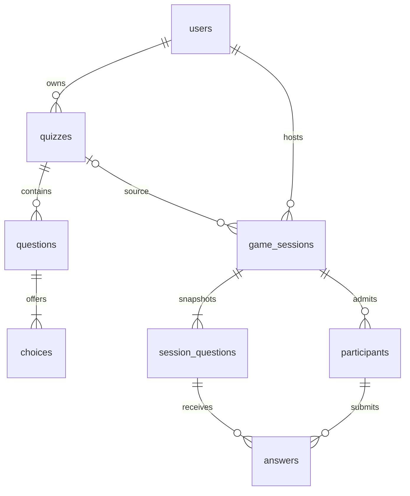
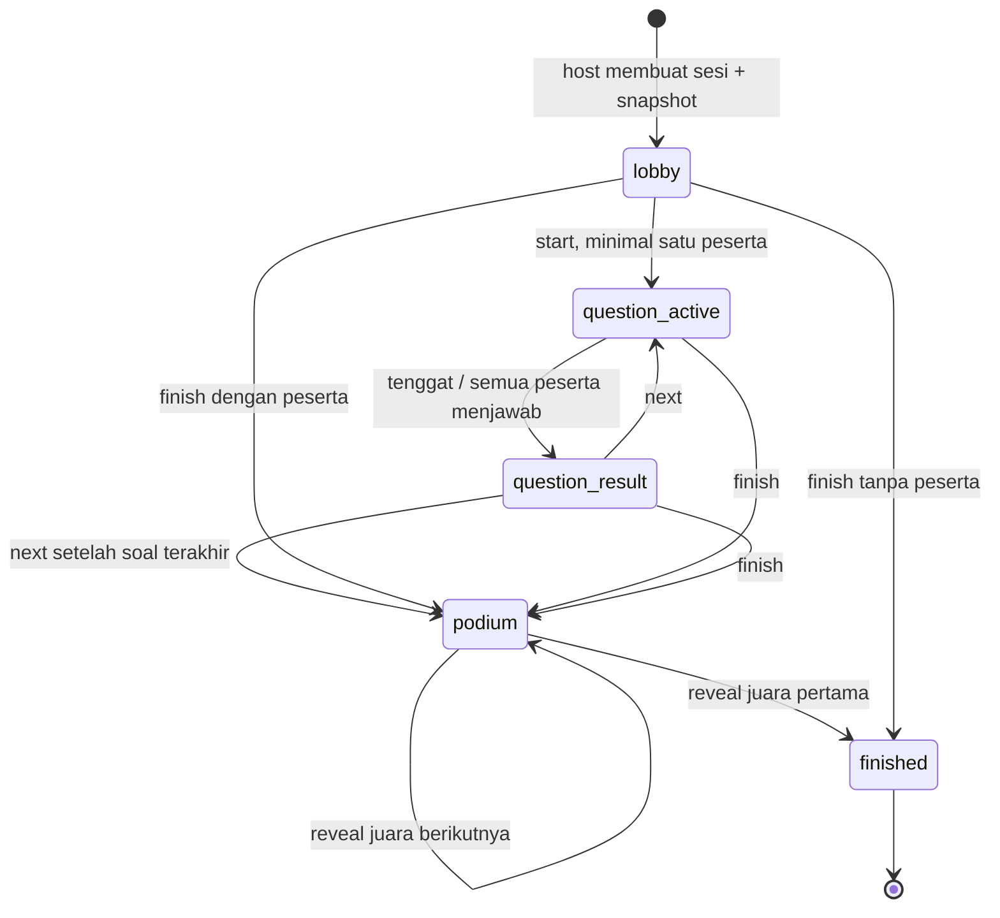

# Arsitektur Cerdas Bersama PTA Papua Barat

MVP monolit Laravel 7.30.7, PHP 7.4.33, database MySQL/InnoDB (pengujian lokal juga memakai MariaDB 10.4.27), Blade, Bootstrap 5.3.3 CSS, dan JavaScript native. Tidak ada Node runtime, WebSocket, layanan berbayar, atau proses build frontend yang diperlukan. Semua font, ilustrasi, Bootstrap, CSS, dan JS disajikan lokal.

## Batas lapisan

`routes/web.php` → middleware session/CSRF/throttle → controller → Form Request + Policy → service → Eloquent/MySQL. QuizController mengelola dokumen kuis dalam transaksi; GameService menjadi satu-satunya pemilik transisi sesi, snapshot, penerimaan jawaban, dan proyeksi state. ScoreService mengimplementasikan rumus murni. Controller peserta menyelesaikan identitas dari token acak 256 bit yang tersimpan pada session server; database hanya menyimpan SHA-256 token. ID peserta dari browser tidak pernah dipakai untuk autentikasi.

## Struktur dan relasi



| Tabel | Kolom utama dan batas |
|---|---|
| users | id, name, email unik, password hash, remember_token |
| quizzes | FK user_id; title, description, cover, theme, status draft/ready; index (user_id,status) |
| questions | FK quiz_id; text, image, duration 5–120 detik, position; unik (quiz_id,position) |
| choices | FK question_id; text, is_correct, position; unik (question_id,position) |
| game_sessions | FK user_id, quiz_id nullable; salinan title, pin, active_pin unik nullable, status, current_position, version, started_at/deadline_at presisi ms, finished_at; index (user_id,status) |
| session_questions | FK game_session_id; salinan text, image path, duration, choices JSON, correct_index, position; unik (game_session_id,position) |
| participants | FK game_session_id; nickname, nickname_key lower-case, token_hash unik, character key (default nala); unik (game_session_id,nickname_key) |
| answers | FK participant_id dan session_question_id; choice_index, is_correct, elapsed_ms, score; unik (participant_id,session_question_id) |

Semua FK memakai cascade kecuali penghapusan kuis → game_sessions.quiz_id menjadi NULL. Riwayat dan snapshot tetap utuh. File gambar tidak dihapus ketika kuis diubah/dihapus karena mungkin masih dirujuk snapshot. Pembersihan file yatim memerlukan pemeriksaan referensi sebelum dihapus.

## Mesin status



Satu lock baris game_sessions mencakup join, jawaban, penyelesaian waktu, dan kontrol host, sehingga operasi untuk sesi yang sama terserialisasi. Semua transaksi memakai retry deadlock 3 kali. Request kontrol wajib membawa `version`; start/next menaikkan versi, sehingga klik berulang/stale tidak melompat dua soal. Status berubah ke hasil pada polling pertama sesudah tenggat jika tidak ada jawaban yang memicunya. Tenggat tetap berlaku meskipun tidak ada polling.

Alokasi PIN: kuis dikunci agar snapshot konsisten dengan editor; baris pengguna dikunci dalam urutan tetap untuk menyerialisasi pembentukan PIN, lalu constraint `active_pin` memberi pertahanan tambahan. PIN selesai dapat dipakai ulang setelah active_pin menjadi NULL. PIN bukan otorisasi kontrol host.

State aktif hanya mengandung pilihan teks dan metadata, tanpa correct_index, is_correct, atau skor jawaban peserta. Hasil soal perantara membuka correct_index, distribusi, dan leaderboard. Hasil soal terakhir menahan semuanya melalui final_pending. Saat podium, hanya pemenang yang sudah diumumkan dikirim (rank 3 lalu 2 lalu 1); leaderboard lengkap dibuka pada finished. Browser menghitung offset jam dari server_now dan waktu tengah request, lalu menghitung sisa waktu dari deadline; browser tidak menentukan tenggat atau skor. Jawaban yang diterima setelah deadline atau untuk ID soal lama ditolak server.

Migration 2026_11_04 menambah podium_step (default 0) dan podium_step_at (ms). Kontrol next terakhir/finish membuka upacara. Kontrol reveal bertransaksi dengan lock/version yang sama, menolak advance sebelum ready_at (8.8 detik pembuka, 7.2 detik berikutnya), dan selesai saat rank 1 diizinkan. Tidak ada nama/skor juara tersembunyi dalam payload podium; participants tetap hanya katalog identitas tanpa rank/skor. Route hasil lengkap masih mensyaratkan finished. Sesi lama finished dengan step 0 tetap memakai hasil tersimpan. podium.js hanya mengatur presentasi, efek dan timer yang dibatalkan saat keluar; refresh memulihkan tahap terakhir tanpa replay. Satu/dua peserta memakai 1 atau 2→1 tanpa juara fiktif.

## Skor dan seri

Proyeksi per-soal: leaderboard juga membawa previous_score (jawaban sebelum snapshot soal aktif), earned_score (selisih total), previous_rank, rank dan rank_change. Standings sebelum/sesudah memakai comparator yang sama. Data hanya disertakan ketika hasil dibuka atau permainan selesai; tidak ada proyeksi skor perolehan pada question_active. UI question_result memakai layar scoreboard khusus dengan animasi presentasional; angka akhir dan urutan selalu berasal dari server. Browser tidak menghitung ulang skor atau mengubah ranking untuk menentukan hasil.

Jawaban benar: `round(1000 - 500 × clamp(elapsed_ms / (duration_seconds × 1000), 0, 1))`.
Contoh: 0/10/20 detik pada soal berdurasi 20 detik → 1000/750/500 poin. Pengiriman tepat pada atau setelah deadline ditolak; nilai 500 tetap mungkin karena pembulatan menjelang deadline. Salah/tidak menjawab → 0. `elapsed_ms` dihitung server dan disimpan bersama score dan is_correct.

Urutan seri: total score terbesar → jumlah jawaban benar terbesar → jumlah elapsed_ms jawaban benar terkecil → ID peserta terkecil (urutan bergabung). Peringkat deterministik dan selalu berupa peringkat urut. Tidak menjawab tidak menambah waktu seri. Total dapat dihitung ulang dari jawaban tersimpan dan snapshot, tanpa cache/browser totals:

```php
$total = $participant->answers->sum(function ($answer) use ($scoreService) {
    $question = $answer->sessionQuestion;
    return $scoreService->calculate(
        $answer->choice_index === $question->correct_index,
        $answer->elapsed_ms,
        $question->duration
    );
});
```

## Polling dan ketahanan

Request berurutan setiap 1500ms, timeout jaringan 8 detik ditangani UI, backoff 5 detik saat gagal; tab tersembunyi/pagehide/finished menghentikan polling. Kembali online/tab aktif melanjutkan. State berversi lebih lama diabaikan. Jawaban dikunci lokal sambil menunggu proyeksi server; constraint unik tetap melindungi terhadap request ganda. Jika respons jawaban terputus setelah commit, polling berikutnya mengembalikan my_answer dan mengunci pilihan.

Login 8/menit dan percobaan PIN 15/menit berbasis identitas default throttle Laravel (tamu berdasarkan IP). Polling 90/menit dan jawaban/kontrol 30/menit memakai bucket session per route agar peserta satu Wi-Fi tidak saling menghabiskan kuota. Cache file sesuai satu server MVP; gunakan cache/session bersama untuk beberapa server.

## Asumsi dan batas MVP

Karakter: daftar putih di config/characters.php; key disimpan pada participants dan ikut proyeksi state/leaderboard. JoinRequest dan GameService memvalidasi key; presenter Characters memetakan ke URL aset lokal dan memberi fallback data lama. Pilihan tidak mengubah skor atau waktu. Migration menambahkan kolom dengan default agar sesi/hasil yang ada tetap terbaca.

Audio: sound.js memiliki satu AudioContext per dokumen, dibuka lewat gesture. Efek memakai oscillator/envelope, volume dibatasi dan master gain rendah. music.js berbagi context dengan bus gain terpisah, decode file WAV lokal sekali, dan memakai satu AudioBufferSource looping saat question_active. State/deadline mengendalikan jeda/berhenti; polling tidak membuat sumber bertumpuk. Musik meredam sesaat saat efek berbunyi. Preferensi efek dan musik disimpan terpisah di localStorage, tanpa data identitas atau rahasia. Initial state setelah refresh tidak memutar ulang cue hasil. Audio tidak mempengaruhi keputusan server. Browser tanpa Web Audio tetap dapat memainkan kuis.

- Satu host mengendalikan satu sesi; tidak ada co-host atau bot peserta. Host boleh memiliki beberapa sesi aktif.
- Peserta hanya dapat pulih dengan cookie browser yang sama selama session belum kedaluwarsa. Menghapus cookie/incognito baru tidak memulihkan identitas.
- Draft adalah kuis valid yang belum dipublikasikan, bukan autosave formulir kosong. Minimal satu soal, 2–4 pilihan, tepat satu benar, maksimal 50 soal.
- Hapus pertanyaan/kuis membutuhkan konfirmasi UI. Penghapusan hasil/sesi belum disediakan.
- Tidak ada sinkronisasi editor antar-tab. Simpan terakhir menang; snapshot sesi tetap aman.
- Sesi yang ditinggal di lobby tetap aktif sampai host menutupnya. Tidak ada cleanup otomatis atau scheduler wajib.
- Belum ada load test kapasitas besar, antivirus upload, email verification/reset password, atau moderasi nama. Gunakan untuk grup kecil di lingkungan pengembangan/terkontrol.
- Laravel 7/PHP 7.4 sudah tidak didukung; audit dependency saat ini belum bersih. Migrasi ke versi terdukung dibutuhkan sebelum pemakaian publik.
